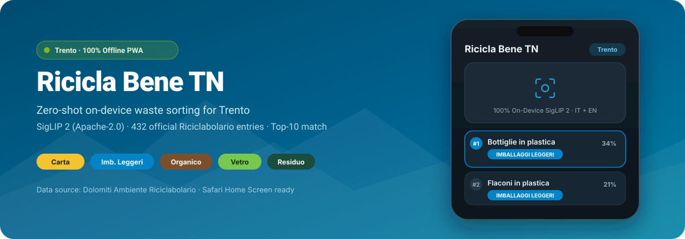
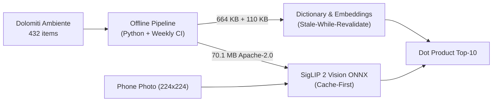

<p align="center">
  
</p>

<p align="center">
  
  <a href="LICENSE"></a>
  
  
</p>

# Ricicla Bene TN

A zero-shot, 100% client-side **PWA** for sorting household waste in **Trento** (*Utenza Domestica*) using Dolomiti Ambiente's official **Riciclabolario**.

Snap a photo → on-device **SigLIP 2 Base** matches it against all **432 official entries** (multilingual IT + EN) and returns the **Top 10** candidates with Trento's color-coded bins — completely offline after first load.

> [!NOTE]
> Unofficial civic project (MIT license), not affiliated with Dolomiti Ambiente S.r.l. or Provincia Autonoma di Trento.

## How It Works

The text encoder never runs on the phone: dictionary embeddings are precomputed once offline (`664 KB`), so the browser only runs the **4-bit ONNX vision encoder** (`70.1 MB`, Apache-2.0) via `onnxruntime-web`.



## Trento Bins

| Categoria | Colore (Trento) | Conferimento |
| :--- | :--- | :--- |
| **CARTA E CARTONE** | Giallo (`#F4C430`) | Contenitore con coperchio giallo |
| **IMBALLAGGI LEGGERI** | Azzurro (`#0284C7`) | Sacchi semitrasparenti azzurri (solo imballaggi) |
| **ORGANICO** | Marrone (`#7B4F2C`) | Contenitore marrone (solo sacchetti in carta) |
| **VETRO** | Verde chiaro (`#78C850`) | Contenitore con coperchio verde chiaro (senza tappi) |
| **RESIDUO** | Verde scuro (`#1B4D3E`) | Contenitore con coperchio verde scuro |
| **CENTRO RACCOLTA** | Ardesia (`#64748B`) | Centri Raccolta / Centro Integrato |
| **FARMACIA** | Ottanio (`#0F766E`) | Contenitori dedicati in farmacia |
| **DITTA SPECIALIZZATA** | Rosso (`#C53030`) | Rifiuti speciali |

## Quick Start

```bash
# Preview PWA locally
python3 -m http.server 8000 --directory web
```

**Rebuild data or model (optional):**
```bash
uv sync --directory pipeline
python3 pipeline/1_scrape_riciclabolario.py
pipeline/.venv/bin/python pipeline/2_build_embeddings.py
pipeline/.venv/bin/python pipeline/3_export_onnx.py
pipeline/.venv/bin/python pipeline/sync_pwa_assets.py
```

## Deployment & Auto-Updates

The PWA is deployed directly from `web/` on **Vercel** (configured via [`vercel.json`](vercel.json)):

- **Install on iPhone:** Open the live Vercel URL in Safari → **Share (`↑`) → Aggiungi alla schermata Home**.
- **Weekly data sync:** [`.github/workflows/update-riciclabolario.yml`](.github/workflows/update-riciclabolario.yml) checks Dolomiti Ambiente every Monday and opens a PR with refreshed JSON/embeddings (`~775 KB`). Merging the PR automatically triggers a Vercel redeploy without changing the cached ONNX model.

## License

[MIT License](LICENSE) — code and `onnxruntime-web` are MIT-licensed; `google/siglip2-base-patch16-224` weights are **Apache-2.0**.
